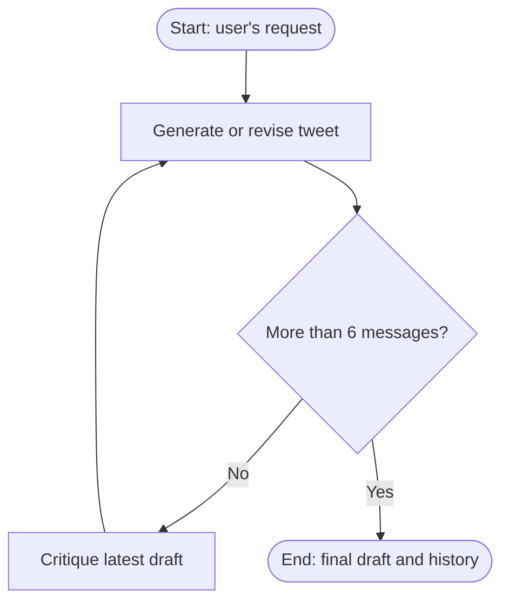

# LangGraph Reflection Agent

A simple reflection agent that improves a tweet through a repeated **generate → critique → revise** workflow. Built with Python, LangGraph, LangChain, and Google Gemini.

The project demonstrates how to turn a single LLM response into a feedback loop: one prompt writes a draft, another reviews it, and the next generation uses that feedback to revise the draft. LangGraph manages the shared message history and decides when the loop ends.

## What this project does

Given a request to improve a tweet, the agent:

1. Generates an initial draft.
2. Critiques the latest draft for style, length, clarity, and potential engagement.
3. Revises the draft using the critique and conversation history.
4. Repeats until the configured message-count limit is reached.
5. Returns the complete conversation, ending with the final draft.

Both roles use the same Gemini model with different prompts. The feedback loop happens during inference; it does not train or update the model.

## Workflow



The generated graph image is also available in [flow.png](flow.png).

### How many times does it run?

The stopping condition is checked **after generation**:

```python
def should_continue(state: MessagesState) -> str:
    if len(state["messages"]) > 6:
        return END
    return REFLECT
```

Starting with the single user message in `main.py`, a successful run follows this sequence:

| Step | Action | Messages in state |
| --- | --- | --- |
| Input | Original user request | 1 |
| 1 | Generate draft 1 | 2 |
| 2 | Critique draft 1 | 3 |
| 3 | Generate draft 2 | 4 |
| 4 | Critique draft 2 | 5 |
| 5 | Generate draft 3 | 6 |
| 6 | Critique draft 3 | 7 |
| 7 | Generate draft 4 and finish | 8 |

That is **four generation calls and three reflection calls**, or seven model invocations. The limit controls message count rather than measuring output quality. Supplying a different initial history changes the number of iterations.

## Technology stack

| Technology | Role in this project |
| --- | --- |
| Python 3.13+ | Application code and type annotations |
| LangGraph | Stateful graph, nodes, conditional routing, and execution |
| LangChain / `langchain-core` | Prompt templates, chat messages, and runnable chains |
| `langchain-google-genai` | Gemini integration through `ChatGoogleGenerativeAI` |
| Google Gemini | Generates drafts and critiques; configured as `gemini-3.5-flash-lite` |
| `python-dotenv` | Loads local API credentials and settings from `.env` |
| uv | Dependency installation and the `uv.lock` lockfile |
| Mermaid | Workflow diagrams in the terminal, README, and generated PNG |
| Black and isort | Formatting tools included in the project dependencies |

Dependency constraints are declared in [pyproject.toml](pyproject.toml); resolved versions are recorded in [uv.lock](uv.lock).

## Project structure

```text
reflection-agent/
├── main.py                         # Graph nodes, routing, sample input, and execution
├── chains.py                       # Generation/reflection prompts and Gemini chains
├── flow.png                        # Generated graph image
├── pyproject.toml                  # Project metadata and dependency declarations
├── uv.lock                         # Locked dependency versions
├── .python-version                 # Local Python version preference: 3.13
├── .env.example                    # Credential placeholders and optional tracing settings
├── .gitignore                      # Excludes virtual environments and local credentials
├── README.md
└── src/
    └── reflection_agent/
        └── __init__.py             # Package scaffold and placeholder console entry point
```

`.env` is created locally and excluded from Git.

## Getting started

### Prerequisites

- Python 3.13 or newer.
- [uv](https://docs.astral.sh/uv/getting-started/installation/) installed.
- A Gemini Developer API key from [Google AI Studio](https://aistudio.google.com/apikey), with access to the model configured in `chains.py`.
- Internet access for Gemini requests and the current PNG diagram renderer.

### 1. Clone the repository

Replace the placeholder URL with this repository's GitHub URL:

```bash
git clone https://github.com/YOUR_USERNAME/YOUR_REPOSITORY.git
cd YOUR_REPOSITORY
```

### 2. Install dependencies

Run from the repository root:

```bash
uv sync --locked
```

This creates the project environment and installs dependencies using the committed lockfile. `--locked` reports an error if the lockfile no longer matches the project configuration. See the [uv locking and syncing documentation](https://docs.astral.sh/uv/concepts/projects/sync/).

### 3. Configure your API key

Create a local environment file.

**Windows PowerShell:**

```powershell
Copy-Item .env.example .env
```

**macOS / Linux:**

```bash
cp .env.example .env
```

Set the required value in `.env`:

```dotenv
GOOGLE_API_KEY=your_actual_google_api_key
```

`main.py` loads this file before importing the model chains. The [LangChain Gemini integration](https://docs.langchain.com/oss/python/integrations/chat/google_generative_ai) documents credentials and backend selection.

LangSmith tracing is optional and disabled in `.env.example`. To enable it, configure your LangSmith credentials and endpoint using the [LangSmith tracing guide](https://docs.langchain.com/langsmith/trace-with-langgraph). These settings are separate from the Gemini API key.

### 4. Run the agent

```bash
uv run --locked python main.py
```

The script uses the sample tweet request defined in `main.py`. On a successful run it:

1. Saves the workflow diagram as `flow.png` in the current working directory.
2. Prints the Mermaid graph definition and a greeting.
3. Executes the generation/reflection loop.
4. Prints the returned state, including the original request, drafts, and critiques.

Use `main.py` to run this workflow. The installed `reflection-agent` console command currently points to the package scaffold and only prints a greeting.

## How the code works

### 1. StateGraph and MessagesState

```python
from langgraph.graph import END, MessagesState, StateGraph

builder = StateGraph(state_schema=MessagesState)
```

`StateGraph` builds the workflow. `MessagesState` describes the data passed between its nodes: a dictionary containing a `messages` list.

`MessagesState` includes the `add_messages` reducer. When a node returns new messages, the reducer merges them into the existing history. Messages with new IDs are appended; an existing message can be updated by returning the same ID. This lets each node return its new message without manually copying the conversation.

`MessageGraph` is deprecated; this project uses `StateGraph` with `MessagesState`. `MessagesState` itself is not deprecated. See the [message API reference](https://reference.langchain.com/python/langgraph/graph/message) and [Graph API overview](https://docs.langchain.com/oss/python/langgraph/graph-api).

### 2. Generation chain

In `chains.py`, the generation prompt instructs the model to write a tweet or revise a previous attempt using the feedback in the history:

```python
generate_chain = generation_prompt | llm
```

The `|` operator connects the prompt template to the chat model. `MessagesPlaceholder` inserts the current conversation into the prompt.

The generation node returns the model response as a state update:

```python
def generation_node(state: MessagesState) -> MessagesState:
    return {"messages": [generate_chain.invoke({"messages": state["messages"]})]}
```

The draft is stored as an AI message.

### 3. Reflection chain

The reflection prompt asks for actionable criticism of the latest draft. It ends with an explicit user instruction to critique that draft and return recommendations without rewriting the tweet:

```python
reflect_chain = reflection_prompt | llm
```

The reflection node converts the critique to a `HumanMessage` before adding it to state:

```python
def reflection_node(state: MessagesState) -> MessagesState:
    res = reflect_chain.invoke({"messages": state["messages"]})
    return {"messages": [HumanMessage(content=res.content)]}
```

This represents the automated critique as feedback for the writer's next turn. It does not pause the workflow for a person to respond.

The extra user instruction belongs to the reflection prompt; it is not appended to the shared graph state or counted toward the stopping condition.

### 4. Routing and compilation

```python
builder.add_node(GENERATE, generation_node)
builder.add_node(REFLECT, reflection_node)
builder.set_entry_point(GENERATE)

builder.add_conditional_edges(
    GENERATE, should_continue, {END: END, REFLECT: REFLECT}
)
builder.add_edge(REFLECT, GENERATE)

graph = builder.compile()
```

Generation routes either to reflection or to `END`. Reflection always routes back to generation. Compiling produces the graph that can be invoked with an initial state.

### 5. Typed input and returned output

The input follows the same schema used by the graph:

```python
inputs: MessagesState = {
    "messages": [HumanMessage(content="Improve this tweet: Learning LangGraph today!")]
}
response = graph.invoke(inputs)
```

The returned state contains the full history. Its sequence is:

```text
HumanMessage: original request
AIMessage:    draft 1
HumanMessage: critique 1
AIMessage:    draft 2
HumanMessage: critique 2
AIMessage:    draft 3
HumanMessage: critique 3
AIMessage:    final draft
```

Generated wording varies between runs. To display just the final draft, use `response["messages"][-1].content` instead of printing the whole state.

## Design choices and troubleshooting

### Prompt imports

`ChatPromptTemplate` and `MessagesPlaceholder` come from `langchain_core.prompts`:

```python
from langchain_core.prompts import ChatPromptTemplate, MessagesPlaceholder
```

Importing them from `langchain_core.messages` caused the original unknown-attribute and non-callable-object type errors.

### Type errors at graph.invoke

Use `inputs: MessagesState` when constructing the input. This gives the type checker the graph's expected schema instead of an inferred `dict[str, list[HumanMessage]]`.

### Gemini model prefilling error

The reflection history ends with the generated draft, an AI message. The installed Gemini adapter rejects requests ending with a model turn for the configured model:

```text
ValueError: Model 'gemini-3.5-flash-lite' does not support model prefilling.
The final request turn must be a user message or a function response.
```

The reflection prompt fixes this by adding a user instruction after the history. The model receives the draft followed by a request to review it. The draft and previous conversation remain available as context.

### Diagram rendering fails before generation starts

The current `draw_mermaid_png(...)` call runs at module level and uses the Mermaid.ink rendering API by default. If that service is unreachable, execution can stop before the first model call. To run without PNG generation, comment out that line in `main.py`; the Mermaid text and the README diagram remain available.

### Authentication, model access, or quota errors

Check that `.env` contains a valid `GOOGLE_API_KEY` and that the configured model is accessible to your account. Gemini requests are subject to provider quotas and any applicable billing. If changing models, update the model ID in `chains.py`.

### LangSmith connection errors

If tracing is enabled, verify the LangSmith API key and regional endpoint. For a run without tracing, set `LANGSMITH_TRACING=false` and check for older `LANGCHAIN_*` tracing settings already present in your environment.

## Customization

| Change | Where to edit |
| --- | --- |
| Try a different tweet | The `inputs` message in `main.py` |
| Change writing style or audience | The generation system prompt in `chains.py` |
| Change critique criteria | The reflection system prompt and final user instruction in `chains.py` |
| Use another accessible Gemini model | The `ChatGoogleGenerativeAI` model ID in `chains.py` |
| Change the number of iterations | The message-count condition in `should_continue` |
| Print only the final draft | The output statement after `graph.invoke(inputs)` |

## Validation and current scope

During development, the prompt templates and complete graph were exercised with mocked model responses. The checks covered message accumulation, routing, the final eight-message history, and termination. After the reflection-prompt fix, all seven requests in that mocked run ended with a user message.

These were development checks; the repository does not currently include an automated test suite. Live Gemini execution after the prompt fix was not verified by those checks.

This is a small learning project with a fixed workflow and a hardcoded example input. Message history is kept within a run, with no configured checkpointer or storage between runs. It does not search the web, call external tools for the writing task, or publish tweets. Critiques are model-generated suggestions, and there is no enforced character limit or automatic quality score.

## Skills demonstrated

- Building a stateful LLM workflow with LangGraph.
- Using `MessagesState`, message reducers, and typed graph inputs.
- Implementing conditional edges and bounded feedback loops.
- Designing separate generation and critique prompts.
- Composing LangChain runnable chains with a Gemini chat model.
- Handling chat message roles and model-specific request constraints.
- Managing local credentials and reproducible Python dependencies.
- Visualizing graph execution with Mermaid.

Possible extensions include a dedicated iteration counter, structured critique output, character-count validation, streaming, persistent checkpoints, and a small user interface.
